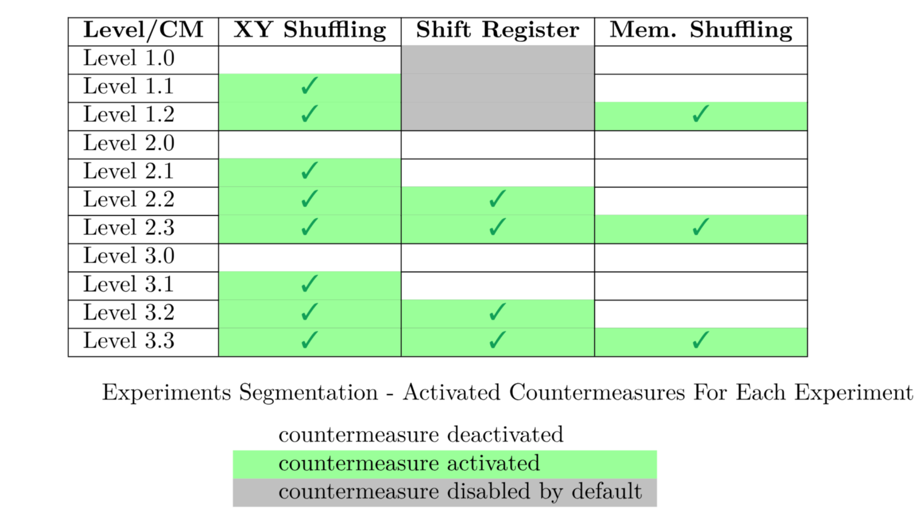
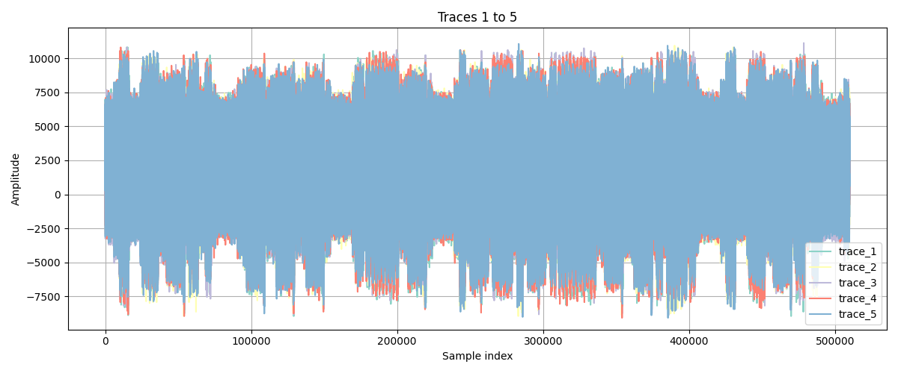
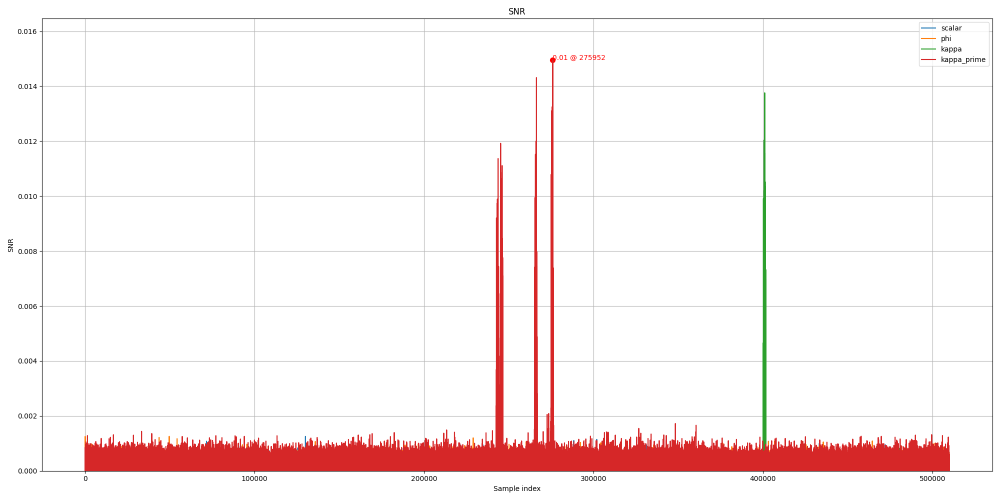

# IPECC | Side Channel Analysis
<p align="justify">
Collection of scripts to perform a complete side-channel analysis flow on IPECC electromagnetic (EM) traces, based on the open-source library <a href="https://scalib.readthedocs.io/">SCALib</a>, related to the research paper <b>IPECC: an Open-Source Side-Channel Resistant ECC Hardware Accelerator</b>, published in the journal TCHES 2027 issue 1.
</p>

## Contents
- [Quickstart](#quickstart)
- [Setup](#setup)
- [Datasets Details](#dataset-details)
- [Dataset Access](#dataset-access)
    - [Dataset Download](#dataset-download)
    - [Dataset Decompression](#dataset-decompression)
    - [Dataset Concatenation](#dataset-concatenation)
- [Usage](#usage)
- [Features](#features)
- [Demonstration](#demonstration)


<!-- <p align="justify"> -->

## Quickstart
<p align="justify">
If you wish to directly test the scripts, the `sca_flow_complete.sh` installs the required dependencies, downloads the two first subsets of the dataset corresponding to Level 3.1, and runs the SCA scripts on them directly. All you need is to run the following bash commands:
</p>

```bash
git clone https://github.com/NinjaLabFr/evaluation-SCA-IPECC
cd evaluation-SCA-IPECC
bash test_all_scripts_level3-1.sh
```
Otherwise, if you wish to dig deeper into the details of this work, please take a look at the following sections.

>[!NOTE]
>To run the provided scripts, you need a computer running Linux or MacOS and Python version being at least 3.9.

>[!NOTE]
> To run the script `sca_flow_complete.sh`, you need at least 140GB of free disk space. More generally, if you download, untar and run the SCA flow on X subsets, you will need at least X.70GB of free disk space.


## Setup
You will need to install the required Python libraries, namely `qECUtils`, `H5Py`, `Jupyter`, `NumPy`, `Matplotlib` and `SCALib`.
<!-- </p> -->

**Linux & macOS**
```bash
python3 -m venv IPECCenv && source IPECCenv/bin/activate
pip install -r requirements.txt
```


## Datasets Details

<p align="justify">
We provide 11 datasets, each one containing 900 EM traces of scalar multiplication computed over the elliptic curve FRP256v1. In the table below, we detail the security configurations of the 11 datasets showcasing the different countermeasures enabled for each dataset. Each line of the table corresponds to one of the 11 configurations / datasets. 

A cell with a green checkmark (✅) conveys that the corresponding countermeasure is activated for the considered configuration / dataset. The ❌ indicates that the countermeasure is disabled by default.
</p>

<!-- <p align="center">

</p> -->

| Level/Countermeasure | XY Shuffling | Shift Register | Memory Shuffling |
|:--------------------:|:------------:|:--------------:|:----------------:|
|       Level 1.0      |              |       ❌       |                  |
|       Level 1.1      |      ✅      |       ❌       |                  |
|       Level 1.3      |      ✅      |       ❌       |        ✅        |
|       Level 2.0      |              |                |                  |
|       Level 2.1      |      ✅      |                |                  |
|       Level 2.2      |      ✅      |       ✅       |                  |
|       Level 2.3      |      ✅      |       ✅       |        ✅        |
|       Level 3.0      |              |                |                  |
|       Level 3.1      |      ✅      |                |                  |
|       Level 3.2      |      ✅      |       ✅       |                  |
|       Level 3.3      |      ✅      |       ✅       |        ✅        |


Each provided dataset contains information about the setup, and for each scalar multiplication:
- the corresponding X affine coordinate value of a random point P,
- the corresponding Y affine coordinate value of a random point P,
- the corresponding k scalar value of $k.P$,
- the corresponding $\phi$ value,
- the corresponding scalar multiplication EM trace,

The content is detailed in the notebook `1_dataset_presentation.ipynb`.  
<!--  -->


## Dataset Access

<p align="justify">
As each of the 11 datasets contains 900 traces of length 150 million samples stored as int16, one dataset has a size of ~270GB. To facilitate their download, each one is split in 9 subsets encompassing 100 traces (with their corresponding inputs). You can execute the SCA flow on one or several subsets of one dataset.
</p>

---
**Dataset Download**

You can test the scripts against (one of) the datasets available via [this link](https://demo.data.gouv.fr/datasets/ascad-ipecc-tches-2027) 

To download a specific dataset subset, you can use the bash oneliner :
```bash
# (replace `X` , `Y` and `N` in the dataset name) 
wget https://anssi.s3.sbg.io.cloud.ovh.net/ipecc/ipecc_level_<X>-<Y>_part_<N>.tar.zst
```

For example, to download the first subset of the dataset level 1-0 (only the first 100 inputs and traces of that dataset), you can use the following bash command:
```bash
wget https://anssi.s3.sbg.io.cloud.ovh.net/ipecc/ipecc_level_1-0_part_0.tar.zst  
```

To download all the subsets of one or several dataset(s), you can use the following bash commands:
```bash
# download the 9 subsets of level 1-0 dataset at once:
wget https://anssi.s3.sbg.io.cloud.ovh.net/ipecc/ipecc_level_1-0_part_{0..8}.tar.zst

# download the 9 subsets of each of the three level 1 datasets at once:
wget https://anssi.s3.sbg.io.cloud.ovh.net/ipecc/ipecc_level_1-{0,1,3}_part_{0..8}.tar.zst

# download the 9 subsets of each of the four levels 2 and 3 datasets at once:
wget https://anssi.s3.sbg.io.cloud.ovh.net/ipecc/ipecc_level_{2,3}-{0..3}_part_{0..8}.tar.zst
```

--- 

**Datasets Decompression**

Once the dataset(s) downloaded, extract the content using the following (replace `X` , `Y` and `N` in the dataset name with the part which you downloaded):
```bash
# Linux
tar -I zstd -xf ipecc_level_X-Y_part_N.tar.zst 

# MacOS
tar -xf ipecc_level_X-Y_part_N.tar.zst
```
(`-xf` extracts the archive file, `-I` selects the compression method but might not be supported on MacOS )

> **Note for MacOS users :** If `zstd` format is not recognized on your machine when decompressing, you can install it using `brew install zstd`

```bash 
# To decompress several datasets at once, you may use the following command 
printf "%s " ipecc_level_X-Y_part_{M,N}.tar.zst | xargs -n 1 tar -I zstd -xf
```

The dataset is an archive of type `.tar.zstd` (compressed with the [zstd](https://facebook.github.io/zstd/) tool) with a unique `ipecc_level_<X>-<Y>_part_<N>.h5` file inside.

--- 

**Datasets Subsets Concatenation**

If you wish to use several subsets of the same dataset, you can concatenate them into one virtual dataset via the command which you can use as argument in the following steps:

```bash
python3 link_datasets.py ipecc_level_1-0_part_0.h5 ipecc_level_1-0_part_1.h5 ... [-o out.h5]
```


## Usage
The script `sca-flow.sh` runs an example flow of the scripts. You can use the command 
```
bash sca-flow.sh <dataset> <dataset-directory>
```
On a standard laptop, this script will run a couple of minutes before ending (using the provided parameters).

If you want to customize the parameters, below is a complete example of usage of each script.

You can also refer to the two following notebooks:
  - `1_dataset_presentation.ipynb` presenting the dataset structure and content,
  - `2_template_attack_on_kappas.ipynb` which is a verbose version of `sca-flow.sh`.

Just launch from the virtual environment
```bash
jupyter notebook
```
and select the notebook in the opened browser.


<br>

## Features
The scripts are based on [SCALib](https://scalib.readthedocs.io/). 

1. `compute_kappas.py` computes:  
    <!-- <p align="center">

    > $\kappa = (k >> 1) \oplus \phi$
    >
    > $\kappa' = (k >> 1) \oplus (\phi << 1)$

    </p> -->

    <p align="center">
     
    </p> 

2. `splitting.py`:
    - splits the EM traces into the scalar multiplication iteration subtraces,
    - adds the corresponding inputs,
    - filter misaligned subtraces (optional),
    - saves the results in an HDF5 file.
3. `compute_snr.py` performs leakage assessment over the subtraces using SNR.
4. `template_attack.py` performs a template attack on the subtraces.
- `plot_traces.py` can be used to plot EM traces of any `.h5` file.


## Demonstration
In this demonstration, we will create a directory `test_level3-1` in which we move our dataset and which will contain all the operations outputs.  

**Step 1: Generating $\kappa$ and $\kappa'$**  
The first step is to generate the inputs $\kappa$ and $\kappa'$ that are used instead of $k$ in the scalar multiplication (which implement the anti-ADPA countermeasure).

```
python3 compute_kappas.py -d test_level3-1/ipecc_level_3-1_part_0.h5 -t test_level3-1

    ┌──────────────────────────────────────────┐
    |         Compute kappa and kappa'         |
    ╰──────────────────────────────────────────╯ 
    
Successfully processed 100 entries.
```
This will generate two new files `inputs_kappa.npy` and `inputs_kappaP.npy` in the directory `test_level3-1`.

**Step 2: Splitting & Resynchronization**

Given the fact that all our inputs are ready now, we split each scalar multiplication trace into 254 subtraces corresponding to the 254 iterations of each scalar multiplication, discard the first and last due to some specificities of these iterations and apply an additional filtering step for subtraces that are not aligned enough.
```
python3 splitting.py -d test_level3-1/ipecc_level_3-1_part_0.h5 -t test_level3-1 -r

    ┌──────────────────────────────────────────┐
    |             Split and Resync             |
    ╰──────────────────────────────────────────╯                  
    
Writing patterns 
Writing patterns 14131/14131
```
This generates a file in the `test_level3-1` directory (option `-t`), named `subtraces.h5`, which corresponds to the sub-traces of the scalar multiplication iterations and their corresponding inputs. 

At the end of the script execution, you can notice the final subtraces number.

If you want to visualize the traces that you resynchronized (or any traces from the dataset or processed data), you can use the script `plot_traces.py`.
For instance, to view the resynchronized sub-traces from the second to the sixth (5 traces starting from offset 1), we can perform the following :

```bash
python3 plot_traces.py -f test_level3-1/subtraces.h5 -n 5 -o 1
```
This will create the PNG file `traces` in the local directory with the corresponding plot. 
<div style="width:75%; text-align: center; margin:auto;">  </div>

**Step 3: Leakage Assessment using SNR**

At this step, we will perform leakage assessment on each on the input bits.

```
python3 compute_snr.py -d test_level3-1/subtraces.h5 -o data

    ┌──────────────────────────────────────────┐
    |             SNR based on SCALib          |
    ╰──────────────────────────────────────────╯                  
        
Traces shape: (14131, 510000)
Inputs shape: (14131,)
Will process 14131 traces starting from index 0.
Processing subtraces 14000:14131

Max SNR for :
	scalar: 0.0013
	phi: 0.0013
	kappa: 0.0138
	kappa_prime: 0.0150

global max is for kappa_prime with 0.0150
2nd global max is for kappa with 0.0138
```
We will obtain a saved PNG corresponding to the SNR results. E.g. : 
<div style="width:75%; text-align: center; margin:auto;">  </div>

**Step 4: Template Attack using LDA**

Finally, given the SNR results, we perform a template attack on the inputs that display high SNR results.

1. We divide our dataset into two subsets : 80% dedicated to building the templates (training) and 20% to perform the predictions (testing).
3.  Using the first subset, and based on the threshold that we set, we select Points Of Interest (PoIs) and perform a template attack (LDA). 
3. Finally, using these results, we predict the inputs of the testing subset, and compute our success rate (as the accuracy of the prediction)

```
python3 template-attack.py -d test_level3-1/subtraces.h5 -i kappa_prime -t 0.0009

    ┌──────────────────────────────────────────┐
    |      Template attacks using SCALib       |
    ╰──────────────────────────────────────────╯                  
      

1. Perform SNR (to select POIs) 
Traces shape: (14131, 510000)
Inputs shape: (14131,)
Will process 11305 traces starting from index 0.
Processing subtraces 11000:11305
POIs: 4018


2. Build templates 
Processing subtraces 11000:11305

3. Predict 
Processing subtraces 13305:14131

Global success rate:  86.94% 

```
